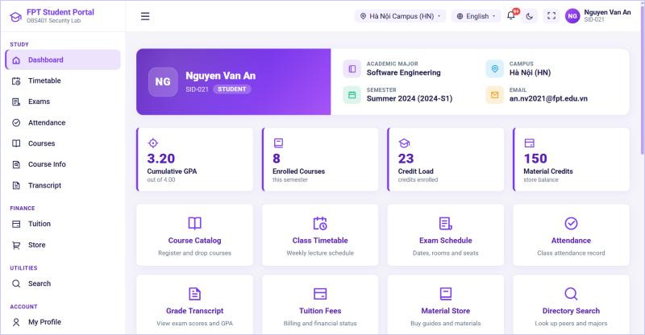
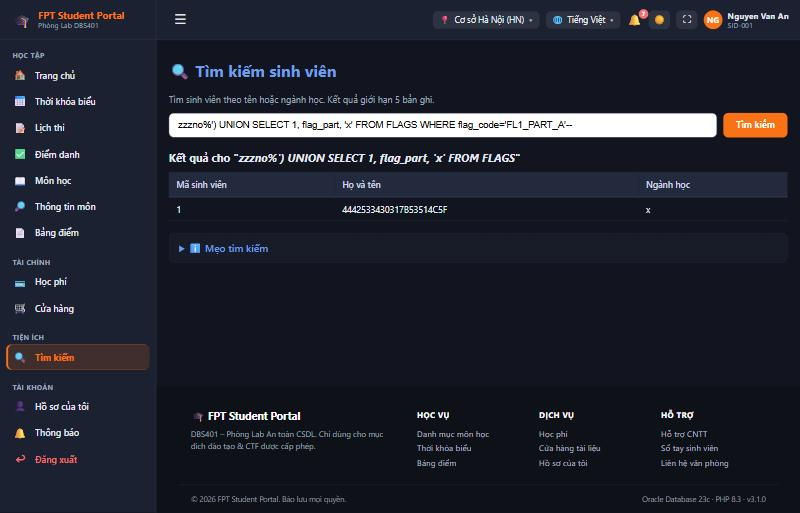
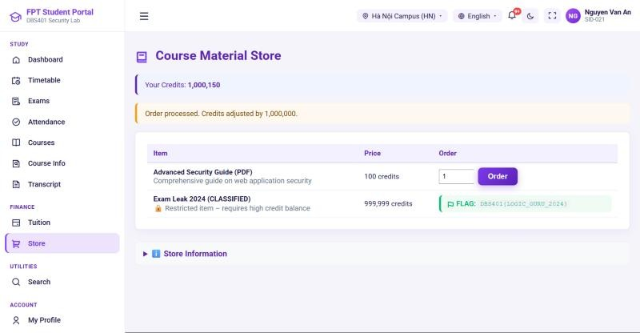
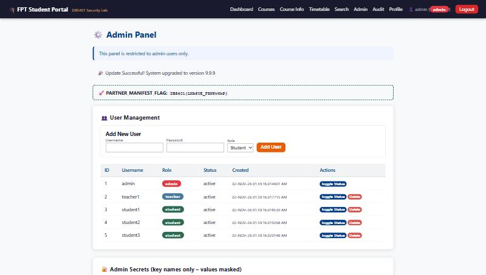

# OracleSecLab – Ứng dụng Web Oracle có lỗ hổng chủ đích
### Phòng thực hành bảo mật & kiểm thử xâm nhập cơ sở dữ liệu Oracle

<p align="center">
  <a href="#công-nghệ-sử-dụng"></a>
  <a href="#công-nghệ-sử-dụng"></a>
  <a href="#công-nghệ-sử-dụng"></a>
  <a href="#công-nghệ-sử-dụng"></a>
  <a href="docs/DOCKER_GUIDE.md"></a>
  <a href="k8s/README.md"></a>
  <a href="https://github.com/Khanh1916/oracle-sec-lab/pkgs/container/oracle-sec-lab-web"></a>
  <a href="#giấy-phép--ghi-nhận"></a>
</p>

<p align="center"><a href="README.md">English</a> · <strong>Tiếng Việt</strong></p>

> **TUYÊN BỐ PHÁP LÝ & ĐẠO ĐỨC:**  
> Ứng dụng này cố ý chứa lỗ hổng và chỉ dành cho mục đích giáo dục, kiểm thử xâm nhập và huấn luyện an ninh trong môi trường phòng thí nghiệm riêng tư, biệt lập. **KHÔNG** triển khai ứng dụng này lên máy chủ công khai hướng Internet hoặc hạ tầng vận hành thực tế.

---

## Tổng quan

**OracleSecLab** là một ứng dụng web mô phỏng quy mô doanh nghiệp, được thiết kế riêng cho việc nghiên cứu **bảo mật cơ sở dữ liệu Oracle**, luyện tập kiểm thử xâm nhập và thi đấu CTF (Capture The Flag).

Trong khi phần lớn các ứng dụng web có lỗ hổng phổ biến (như DVWA, WebGoat hay Juice Shop) tập trung vào MySQL, PostgreSQL hoặc SQLite, **Oracle Database** lại có những đặc thù kiến trúc riêng, cú pháp SQL riêng (`DUAL`, `ROWNUM`, `FETCH FIRST`, `USER_TABLES`, `SYS_CONTEXT`) và những thách thức bảo mật riêng biệt.

Dự án mô phỏng một cổng thông tin sinh viên sát thực tế (**FPT Student Portal**), bao gồm đầy đủ các nghiệp vụ học vụ cùng bốn lỗ hổng chủ đích được thiết kế nhiều tầng.

**Trải nghiệm portal** (thuần giao diện — không ảnh hưởng logic thử thách):

* **Nghiệp vụ học vụ:** Trang chủ, Thời khóa biểu, **Lịch thi**, **Điểm danh**, Môn học, Bảng điểm, Học phí, Cửa hàng, Tìm kiếm, Chấm điểm (giảng viên), Quản trị/Nhật ký (admin).
* **Tài khoản sinh viên:** **Hồ sơ** (sửa liên hệ, đổi mật khẩu) và **Trung tâm thông báo** (đã đọc/chưa đọc, chuông thông báo).
* **Giao diện sidebar bên trái + header trên gọn**, thu gọn thành thanh icon (lưu theo người dùng), off-canvas trên mobile.
* **Song ngữ Tiếng Việt / English**, **chế độ Sáng / Tối**, và **cơ sở chính cố định theo từng sinh viên** (Hà Nội, Đà Nẵng, Cần Thơ, TP. Hồ Chí Minh, Quy Nhơn).

---

## Demo

Một cổng thông tin học vụ sát thực tế với ba lỗ hổng chủ đích, có thể khai thác liên hoàn:

| Bảng điều khiển sinh viên | Thử thách 1 — SQL injection kiểu UNION trên Oracle |
|:---:|:---:|
|  |  |
| **Thử thách 2 — lỗ hổng logic số lượng âm** | **Thử thách 3 — đầu độc chuỗi cung ứng** |
|  |  |

> Các flag hiển thị là giá trị ngẫu nhiên của một phiên chạy `RANDOMIZE_FLAGS=1`, không phải đáp án thật.

---

## Công nghệ sử dụng

| Thành phần | Công nghệ | Mô tả |
|:---|:---|:---|
| **Ngôn ngữ backend** | PHP 8.3+ | Môi trường kịch bản phía máy chủ, quản lý phiên |
| **Hệ quản trị CSDL** | Oracle Database XE 21c / 23c Free | RDBMS doanh nghiệp chạy trên Pluggable Database (`XEPDB1` / `FREEPDB1`) |
| **Trình điều khiển CSDL** | PHP OCI8 & Oracle Instant Client 21c | Tiện ích mở rộng Oracle Call Interface ở tầng C |
| **Máy chủ web** | Apache 2.4 (`mod_php`, `mod_rewrite`) | Máy chủ HTTP với alias thư mục & kiểm soát truy cập |
| **Hệ điều hành** | Ubuntu 20.04 / 22.04 / 24.04 LTS | Môi trường Linux mục tiêu |
| **Công cụ khai thác** | Python 3 (`requests`, `urllib3`) | PoC khai thác tự động và bộ giải mã, ghép flag |
| **Chuẩn bảo mật** | OWASP Top 10 (A01: BAC, A03: Injection, A06: Supply Chain) | Chuỗi tấn công sát thực tế và các bản vá an toàn |
| **Đóng gói** | Docker & Docker Compose | Lab một lệnh, đa nền tảng (không cần cài Oracle thủ công) |
| **Điều phối** | Kubernetes (tùy chọn) | Triển khai đa phiên: mỗi sinh viên/đội một bản độc lập cho sự kiện CTF |
| **CI/CD** | GitHub Actions + GHCR | Dựng image web mỗi lần push và xuất bản `ghcr.io/khanh1916/oracle-sec-lab-web` |

---

## Ma trận lỗ hổng & thử thách CTF

Ứng dụng có **4 lỗ hổng cốt lõi** với flag CTF nhiều bước, kèm nhiều mồi nhử để làm khó các trình quét tự động:

| Thử thách | Loại lỗ hổng | Điểm vào | Độ khó (lỗi) | Độ phức tạp (flag) | Định dạng flag |
|:---|:---|:---|:---:|:---:|:---|
| **Thử thách 1** | SQL Injection UNION (Oracle) | `search.php?q=` | Dễ | Rất khó | `DBS401{...}` |
| **Thử thách 2** | Lỗi logic nghiệp vụ | `store.php` (POST) | Khó | Rất khó | `DBS401{...}` |
| **Thử thách 3** | Kiểm soát truy cập & chuỗi cung ứng | `partner_config.php` + `admin.php` | Khó | Rất khó | `DBS401{...}` |
| **Thử thách 4** | PL/SQL Injection (`EXECUTE IMMEDIATE`) | `course_lookup.php` | Trung bình | Khó | `DBS401{...}` |

> Giá trị flag được cố ý ẩn đi để giữ tính thử thách. Giảng viên có thể xem toàn bộ flag và lời giải từng bước trong [`docs/ANSWER_KEY.md`](docs/ANSWER_KEY.md).

### Tóm tắt các thử thách
1. **Thử thách 1 – SQL Injection Oracle dạng phân mảnh:**
   * Tham số `?q=` tại `search.php` dùng phép nối chuỗi.
   * Danh sách chặn DDL yếu (`DROP`, `ALTER`) dễ dàng bị vượt qua bằng `UNION SELECT`.
   * Flag 1 được chia thành ba bảng khác nhau với ba cách mã hóa khác nhau:
     * **Phần A (Hex):** trong bảng `FLAGS` (`FL1_PART_A`).
     * **Phần B (Chuỗi đảo ngược):** trong bảng `AUDIT_LOGS` (`metadata_note`).
     * **Phần C (Base64):** trong bảng `CONFIG_STORE` (`sys_alpha_marker`).
2. **Thử thách 2 – Thao túng tín chỉ (Số lượng âm):**
   * Cửa hàng tài liệu (`store.php`) kiểm tra `credits >= cost` nhưng quên kiểm tra `quantity > 0`.
   * Đặt số lượng âm biến phép trừ thành phép cộng tín chỉ (`credits - (-2.000.000) = credits + 2.000.000`).
   * Tích lũy đủ tín chỉ cho phép mua món "Exam Leak 2024 (CLASSIFIED)" để lộ Flag 2.
3. **Thử thách 3 – Đầu độc chuỗi cung ứng qua lỗi kiểm soát truy cập:**
   * Điểm vào ẩn `partner_config.php` không kiểm tra quyền admin, cho phép bất kỳ sinh viên nào ghi đè `CONFIG_STORE.update_url`.
   * Khi quản trị viên kiểm tra cập nhật (`admin.php?check_updates=1`), máy chủ tải về một manifest JSON do kẻ tấn công kiểm soát.
   * Nếu phiên bản trong manifest cao hơn `APP_VERSION`, `admin.php` ghép mảnh hex của manifest với hậu tố cố định phía máy chủ và lộ Flag 3.
4. **Thử thách 4 – PL/SQL Injection của Oracle (`EXECUTE IMMEDIATE`):**
   * `course_lookup.php` truyền mã môn học qua **biến ràng buộc** (bind), nhưng stored function `FN_COURSE_LOOKUP` lại dựng truy vấn bằng phép nối chuỗi bên trong `EXECUTE IMMEDIATE` — nên injection xảy ra trong PL/SQL chứ không phải ở tầng PHP. Tham số hóa ở ranh giới ứng dụng **không** cứu được một stored program có lỗ hổng.
   * Hàm trả về một giá trị duy nhất qua `... INTO`, nên một `UNION SELECT` ngây thơ vào bảng `PLSQL_VAULT` (có mồi nhử) sẽ gây `TOO_MANY_ROWS`; kẻ tấn công phải trả về đúng một hàng.
   * Flag 4 nằm trong `PLSQL_VAULT` (`label='CHALLENGE_4'`), chỉ truy cập được qua hàm có lỗ hổng.

---

## Tài khoản dựng sẵn

| Tên đăng nhập | Mật khẩu | Vai trò | Mô tả |
|:---|:---|:---:|:---|
| `admin` | `Admin@DBS401!2024` | **Admin** | Quản trị toàn hệ thống, quản lý người dùng, kích hoạt cập nhật |
| `teacher1` | `Teacher@123` | **Giảng viên** | Giảng viên, cổng chấm điểm, tra cứu sinh viên |
| `student1` | `Student@123` | **Sinh viên** | Sinh viên đang hoạt động, 150 tín chỉ |
| `student2` | `Student@123` | **Sinh viên** | Sinh viên với 50 tín chỉ |
| `student3` | `Student@123` | **Sinh viên** | Sinh viên với 200 tín chỉ |

---

## Bắt đầu nhanh & Cài đặt

### Phương án A — Docker Compose (khuyến nghị, đa nền tảng)
Cách nhanh nhất để chạy toàn bộ lab (Oracle + cổng thông tin) mà **không phải cài Oracle thủ công**. Chạy được trên Linux, macOS và Windows với Docker Desktop:
```bash
git clone https://github.com/Khanh1916/oracle-sec-lab.git
cd oracle-sec-lab
docker compose pull        # tải image web dựng sẵn từ GHCR
docker compose up -d
```
Sau đó mở **http://localhost:8080/dbs401-oracle-app**. Lần khởi động đầu mất vài phút để Oracle khởi tạo. Image web được CI dựng sẵn và xuất bản lên [GHCR](https://github.com/Khanh1916/oracle-sec-lab/pkgs/container/oracle-sec-lab-web); nếu muốn tự dựng, dùng `docker compose up -d --build` (khoảng 10–15 phút). Đặt lại lab bất cứ lúc nào bằng `docker compose down -v`. Xem chi tiết tại [docs/DOCKER_GUIDE.md](docs/DOCKER_GUIDE.md).

> Yêu cầu Docker Compose v2 và tối thiểu ~4 GB RAM trống. Image là `linux/amd64`.

### Phương án B — Cài đặt tự động trên máy ảo (Ubuntu)
Sao chép kho mã và chạy trình cài đặt với quyền quản trị:
```bash
git clone https://github.com/Khanh1916/oracle-sec-lab.git /var/www/html/dbs401-oracle-app
cd /var/www/html/dbs401-oracle-app
sudo bash setup.sh
```

### Phương án C — Kubernetes (CTF nhiều đội)
Kubernetes **không** nhằm làm lab nhẹ hơn — trên một máy, hãy dùng Docker Compose. Mục đích của nó là chạy **nhiều bản độc lập cùng lúc** trên hạ tầng dùng chung: mỗi sinh viên hoặc mỗi đội một bản riêng trong một namespace riêng, nên thao tác khai thác của đội này không bao giờ ảnh hưởng cơ sở dữ liệu hay flag của đội khác.

```bash
# Triển khai một bản (image web tự động kéo từ GHCR)
kubectl create namespace oracle-sec-lab
kubectl apply -k k8s/ -n oracle-sec-lab
kubectl port-forward -n oracle-sec-lab svc/web 8080:80
```
Hướng dẫn đầy đủ cho mô hình nhiều đội, Ingress và hạn mức tài nguyên: [k8s/README.md](k8s/README.md).

### Flag ngẫu nhiên cho từng bản (tùy chọn)
Mặc định lab dùng giá trị flag cố định. Để mỗi bản có flag ngẫu nhiên riêng (hữu ích cho thi đấu, vì đáp án công khai không còn áp dụng), khởi động với:
```bash
RANDOMIZE_FLAGS=1 docker compose up -d
```
Flag được sinh một lần và lưu trong cơ sở dữ liệu nên ổn định suốt sự kiện; cơ chế khai thác của cả ba thử thách hoàn toàn không đổi, chỉ giá trị flag thay đổi.

---

## Công cụ kiểm thử & xác minh

Thư mục `tools/` cung cấp tiện ích để xác minh, khai thác và giải mã các thử thách:
```bash
# 1. Kiểm tra trước khi chạy (đảm bảo môi trường & tệp đầy đủ)
php tools/verify_setup.php

# 2. Khai thác tự động Thử thách 3 (đầu độc chuỗi cung ứng)
python3 tools/exploit_flag3_local.py --target-host 127.0.0.1 --target-port 80

# 3. Giải mã & ghép toàn bộ flag CTF
python3 tools/decode_helper.py --assemble
```

Kho mã còn có bài kiểm thử đầu-cuối ([tests/e2e_challenges.py](tests/e2e_challenges.py)) tự dựng toàn bộ stack và khai thác cả ba thử thách; CI chạy bài này tự động để bảo đảm các thử thách luôn có thể giải được.

---

## Phiên bản an toàn & khắc phục

Mỗi điểm vào có lỗ hổng đều có một bản cài đặt đã được gia cố tương ứng trong `secure_versions/`:

| Điểm vào có lỗ hổng | Bản an toàn | Cơ chế phòng thủ áp dụng |
|:---|:---|:---|
| `search.php` | `secure_versions/search_secure.php` | Truy vấn tham số hóa với biến ràng buộc (`:kw`), giới hạn độ dài, danh sách trắng regex nghiêm ngặt. |
| `store.php` | `secure_versions/store_secure.php` | Kiểm tra số nguyên dương phía máy chủ (`$qty > 0`), xác minh tín chỉ nguyên tử. |
| `partner_config.php` | `secure_versions/partner_config_secure.php` | Phân quyền theo vai trò (`$_SESSION['role'] === 'admin'`), danh sách trắng tên miền. |
| `admin.php` | `secure_versions/admin_update_secure.php` | Danh sách trắng URL cập nhật, từ chối manifest bên thứ ba không tin cậy. |
| `course_lookup.php` | `secure_versions/course_lookup_secure.php` | Sửa stored function: dùng SQL tĩnh (không nối chuỗi) hoặc `EXECUTE IMMEDIATE ... USING` có ràng buộc, quyền invoker. |

---

## Tài liệu kỹ thuật

Để tìm hiểu sâu về kiến trúc và kỹ thuật khai thác, xem thư mục `docs/`:
* [Kiến trúc hệ thống](docs/ARCHITECTURE.md) – Tương tác giữa các thành phần, sơ đồ mạng và ma trận RBAC.
* [Hướng dẫn triển khai](docs/DEPLOYMENT_GUIDE.md) – Hướng dẫn cài đặt Oracle XE và OCI8 trên Ubuntu từng bước.
* [Hướng dẫn giải thử thách](docs/ANSWER_KEY.md) – Lời giải đầy đủ, payload SQL và giải thích các mồi nhử.
* [Cheatsheet SQLi Oracle](docs/ORACLE_PAYLOAD_CHEATSHEET.md) – Tổng hợp kỹ thuật injection đặc thù Oracle.

---

## Tác giả & người bảo trì

* **khanhnn** – Kiến trúc dự án & Nghiên cứu bảo mật
* **Cao Thanh Lam** – Phát triển Full-Stack & Thiết kế CTF
* **Nguyen Huu Phuc** – Mã nguồn ban đầu & Kiến trúc nền tảng
* **Nguyen Cong Tien** – Kiểm thử xâm nhập & Đảm bảo chất lượng (QA)
* **Nguyen Hai Anh** – Tài liệu kỹ thuật & Cơ sở tri thức

---

## Đóng góp & Bảo mật

- **Đóng góp:** xem [CONTRIBUTING.md](CONTRIBUTING.md). Quy tắc cần nhớ — các lỗ hổng trong thử thách là cố ý; đừng "vá" chúng trong ứng dụng chính (bản đã vá nằm trong [`secure_versions/`](secure_versions/)).
- **Bảo mật:** các điểm yếu được mô tả là có chủ đích và **không** cần báo cáo. Với những vấn đề vượt ra ngoài phạm vi thử thách (thoát container, lộ máy chủ, lỗi công cụ), xem [SECURITY.md](SECURITY.md).

---

## Giấy phép & Ghi nhận

Dự án được cấp phép theo **Giấy phép MIT** – xem tệp [LICENSE](LICENSE) để biết chi tiết.

Bản quyền (c) 2024-2026 **khanhnn**, **Cao Thanh Lam**, **Nguyen Huu Phuc**, **Nguyen Cong Tien**, **Nguyen Hai Anh**. Phát hành cho mục đích giáo dục bảo mật cơ sở dữ liệu và nghiên cứu tấn công/phòng thủ.
